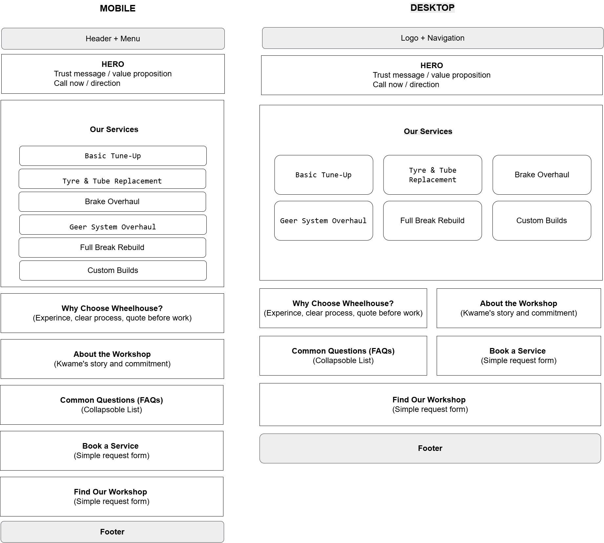

# Wheelhouse Bike Repair

A responsive website rebuild for Wheelhouse Bike Repair, a small bicycle repair and tune-up workshop located in Adum Commercial Area, Kumasi, Ghana.

**Live Website (GitHub Pages):** [https://zakari999.github.io/wheelhouse-bike-repair/](https://zakari999.github.io/wheelhouse-bike-repair/)  
**GitHub Repository:** [https://github.com/zakari999/wheelhouse-bike-repair](https://github.com/zakari999/wheelhouse-bike-repair)

This project focuses on improving mobile usability, WCAG 2.2 Level AA accessibility, visual consistency, and customer confidence while establishing a practical, professional design suited to an active bicycle repair workshop.

---

## 1. Project Overview

Wheelhouse Bike Repair is operated by Kwame, who handles repairs personally and supervises all mechanical work.

The original website contained valuable information about the workshop and its services but suffered from severe usability, accessibility, and responsiveness defects: a fixed 960px desktop width, zero mobile adaptability, inconsistent inline styling across cards, placeholder navigation links that led nowhere, and buried contact channels.

The objective of this rebuild was to eliminate these barriers, establish an accessible mobile-first experience, implement a coherent trade-workshop design system, and make it effortless for customers to understand services, compare indicative prices, and contact the workshop.

---

## 2. Project Objectives

- **Semantic Page Architecture:** Rebuild the website using modern, valid HTML5 landmarks (`<header>`, `<nav>`, `<main>`, `<section>`, `<article>`, `<footer>`) with an unbroken heading hierarchy (`<h1>` &rarr; `<h2>` &rarr; `<h3>`).
- **Mobile-First Responsive Layout:** Implement a fluid layout across mobile, tablet, and desktop viewports using CSS Grid and Flexbox without horizontal overflow.
- **WCAG 2.2 Level AA Accessibility:** Guarantee full keyboard operability without traps, high-contrast focus rings (`:focus-visible`), native disclosure controls, screen-reader status announcements (`aria-live`), and persistent form error identification.
- **Concrete Design System:** Establish a restrained, professional colour palette, modular typography scale, and harmonic spacing system substantiating workshop reliability.
- **Fast Contact Pathways:** Surface clear direct contact actions (`tel:`, WhatsApp, physical location in Adum) throughout the primary user journey.
- **Genuine Customer Improvement:** Introduce the "What's going on with your bike?" symptom filter to bridge everyday customer language with technical repair services.

---

## 3. Initial Sketch & Layout Reasoning

The layout follows a mobile-first hierarchy designed for customers searching for bicycle repairs on their phones while on the go in Kumasi:

1. **Header & Hero:** Introduces the workshop immediately with Kwame's authentic photo, personal service guarantee, and direct calls to action (*Request a repair* and *Explore services*).
2. **Trust Strip:** Reinforces reliability upfront with 4 key customer commitments (*Upfront quotes*, *Same-day basic repairs*, *All everyday bike types*, *Adum, Kumasi location*).
3. **Problem Selector ("What's going on with your bike?"):** Positioned immediately before the services catalogue so hurried visitors can tap a symptom and filter the catalogue in one touch.
4. **Services & Pricing Catalogue:** Displays all 6 repair offerings in structured cards with transparent starting prices and turnaround times.
5. **How It Works:** Outlines the 3-step repair process (*Tell us the problem*, *Get a clear quote*, *Get rolling again*), reinforcing transparency.
6. **About Wheelhouse:** Introduces Kwame's background, workshop ethos, and visual certification stamp (*Est. 2019, Adum, Kumasi*).
7. **Repair Request Form & Direct Contact:** Provides an accessible enquiry form generating pre-filled WhatsApp messages, alongside direct phone calling and workshop hours.
8. **Frequently Asked Questions:** Answers common customer concerns (*Booking ahead*, *Turnaround times*, *Pricing upfront*, *Bike types*, *Overnight storage*) using native disclosure controls.
9. **Workshop Location & Directions:** Highlights the Adum Commercial Area home base with custom map artwork, hours, and direct Google Maps navigation.
10. **Footer & Floating Controls:** Offers quick navigation links, copyright, and a circular floating "Back to top" button accessible via keyboard.

### Pre-Implementation Layout Sketch

The initial layout structure was wireframed prior to implementation using draw.io to establish component relationships, content priority, and responsive adaptations across viewports.



*Direct file link:* [Pre-Implementation Wireframe Sketch (draw.io / PNG)](docs/ee01/sketches/sketch-description.drawio.png)

#### Wireframe Structure & Alignment Reasoning:
- **Mobile Viewport Structure (375px–412px):** Single-column stacked flow; primary call action in top navigation; full-width symptom tiles; stacked service cards; fluid container padding (`calc(100% - 38px)`); persistent bottom call-to-action bar (`.mobile-cta`).
- **Tablet Viewport Structure (650px–850px):** 2-column service card grid (`repeat(2, 1fr)`); 2-column booking layout; expandable mobile menu drawer; increased container padding.
- **Desktop Viewport Structure (1024px–1256px):** Centered max-width container (`1256px`); static horizontal navigation bar; 2-column hero with mechanic photo; 4-column problem grid; 3-column services grid; side-by-side booking and location sections; 3-column footer.

---

## 4. Website Rebuild & Implemented Design System

The redesign was built using semantic HTML5, modern CSS3, and lightweight vanilla JavaScript. The stylesheet is organised into clear modular layers: foundational design tokens (`:root`), base resets, responsive layout containers, component patterns, accessible interactive states, and structured media queries.

### Implemented Design Tokens (`css/styles.css`)

All design tokens are defined in [`css/styles.css`](css/styles.css) under `:root`:

```css
:root {
  --ink: #182f27;
  --ink-2: #244638;
  --forest: #15382b;
  --forest-deep: #102b21;
  --lime: #def58c;
  --lime-dark: #c5ed63;
  --cream: #f7f7f1;
  --paper: #ffffff;
  --muted: #3d5044;
  --line: #e3e9e1;
  --shadow: 0 20px 60px rgba(15, 38, 24, 0.08);
}
```

#### 1. Concrete Colour Palette & Contrast Verification

| Token | Hex Value | Role / Usage in Interface | Contrast on Background | WCAG Level |
| :--- | :--- | :--- | :--- | :--- |
| `--ink` | `#182f27` | Primary body text, headings, dark button text | **14.24:1** on `#ffffff` / **13.24:1** on `#f7f7f1` | **Passes AAA** |
| `--ink-2` | `#244638` | Secondary body text, navigation link resting color | **9.82:1** on `#ffffff` | **Passes AAA** |
| `--forest` | `#15382b` | Deep forest brand color, dark button fill, primary focus ring | **12.86:1** on `#ffffff` | **Passes AAA** |
| `--forest-deep` | `#102b21` | Deepest brand green, site footer background, dark chrome | Background surface | **Surface** |
| `--lime` | `#def58c` | High-contrast brand lime accent, primary CTA button fill, dark focus ring | **10.05:1** on `#173d2f` / **12.63:1** on `#102b21` | **Passes AAA** |
| `--lime-dark` | `#c5ed63` | Interactive hover state for lime buttons | **9.25:1** on `#15382b` | **Passes AAA** |
| `--cream` | `#f7f7f1` | Warm off-white page background canvas | Background canvas | **Surface** |
| `--paper` | `#ffffff` | Pure white background for content cards and form containers | Background surface | **Surface** |
| `--muted` | `#3d5044` | Secondary copy, descriptions, and metadata | **8.64:1** on `#ffffff` / **8.04:1** on `#f7f7f1` | **Passes AAA** |
| `--line` | `#e3e9e1` | Subtle decorative divider lines and container borders | Decorative divider (1.21:1 on `#ffffff`) | **Exempt (WCAG 1.4.11)** |
| Error Red | `#b3261e` | Form validation error text, invalid input border, error ring | **7.60:1** on `#ffffff` / **6.27:1** on `#fff9f8` | **Passes AA** |
| Error Alert | `#991b1b` on `#fdf2f2` | Form error notification banner | **7.58:1** contrast | **Passes AAA** |
| Success Alert | `#1e4620` on `#edf7ed` | Form success notification banner | **9.80:1** contrast | **Passes AAA** |

#### 2. Concrete Typography Scale

Typography is rendered using a modern, legible font pair: **DM Sans** for clear body copy and form readability, and **Manrope** for bold, clean headings.

| Token / Usage | CSS rem | Pixel Equivalent | Line Height | Implementation Usage |
| :--- | :--- | :--- | :--- | :--- |
| Minor Metadata / Kickers | `0.78125rem`–`0.8125rem` | 12.5px–13px | `1.2`–`1.4` | Kickers (`.section-kicker`, `.eyebrow`), badge labels, service numbers (`.service-num`) |
| Footnotes & Form Disclaimers | `0.8125rem` | 13px | `1.4`–`1.6` | Pricing footnote, form help disclaimer, inline error text (`.field-error`) |
| UI Navigation & Buttons | `0.84375rem`–`0.8750rem` | 13.5px–14px | `1.1`–`1.3` | Header navigation links (`.main-nav > a`), button labels (`.btn`), text links |
| Card Body & Inputs | `0.8750rem`–`0.9375rem` | 14px–15px | `1.6`–`1.85` | Service card copy, form inputs, textarea values, problem card copy |
| Subheadings & Form Titles | `0.9375rem`–`1.0000rem` | 15px–16px | `1.3` | Problem card title, FAQ question summary triggers |
| Base Body Text | `1.0000rem` | 16px | `1.6` | Standard paragraph text (`body`), lead descriptions |
| Sub-section Titles (`<h3>`) | `1.3750rem` | 22px | `1.1`–`1.3` | Service card names (`h3`), process step headings |
| Form Card Heading | `1.6875rem` | 27px | `1.2` | Repair request form title (`.form-title h3`) |
| Major Section Headings (`<h2>`) | Fluid clamp | 34px–45px (mobile)<br>40px–56px (desktop) | `1.15` | Section titles (`#problem-title`, `#services-title`, etc.) |
| Hero Main Title (`<h1>`) | Fluid clamp | 34px–61px (mobile)<br>50px–80px (desktop) | `1.08` | Primary page heading (`#hero-title`) |

> [!NOTE]
> **Low-Vision Readability Justification:** In response to user experience and accessibility audits, all small text elements across the interface were systematically raised above comfortable minimums: primary UI labels (navigation links and action buttons) sit at **13.5px–14px** (`0.875rem`), form labels at **14px**, and section kickers, fine print, and metadata were elevated to **12.5px–13px** with high-contrast forest ink (`#285235` / `#182f27`), ensuring effortless scanning for low-vision users and single-handed mobile readers without eye strain.

#### 3. Concrete Spacing & Layout Metrics

Component-level spacing adheres to a 4px/8px incremental scale, complemented by proportional section insets and fluid responsive container widths:

| Spacing Token | CSS rem | Pixels | Applied Implementation |
| :--- | :--- | :--- | :--- |
| `space-4` | `0.25rem` | 4px | Inline icon gaps, badge vertical offsets, error margins |
| `space-8` | `0.50rem` | 8px | Button icon gaps, field label spacing, trust bullet gap |
| `space-12` | `0.75rem` | 12px | Card element gaps, hero action buttons gap, nav item spacing |
| `space-16` | `1.00rem` | 16px | Grid gap on service cards, input padding |
| `space-20` | `1.25rem` | 20px | Form submit button vertical padding (`padding: 20px 21px;`) |
| `space-28` | `1.75rem` | 28px | Card interior padding, sub-heading bottom margins |
| `space-40` | `2.50rem` | 40px | Form card padding, section grid gaps |

##### Layout Insets & Fluid Margins:
- **Mobile Container Gutter:** Fluid width `calc(100% - 38px)`, establishing a consistent 19px lateral margin on small viewports.
- **Section Vertical Insets:** `115px` (`7.19rem`) vertical padding on desktop viewports, scaling down to `72px` (`4.50rem`) on mobile viewports below 650px.

#### 4. Responsive Breakpoints & Viewport Architecture

Layout adjustments are driven by 5 explicit CSS media query breakpoints:

1. **`1150px` (`@media (max-width: 1150px)`):** Laptop adaptation — container width capped at `min(100% - 52px, 1256px)`; hero height scaled to `590px`; navigation gap reduced to `20px`.
2. **`850px` (`@media (max-width: 850px)`):** Tablet adaptation — topbar secondary details hide; header menu switches to accessible hamburger toggle (`.menu-toggle`) with expandable sliding drawer (`.main-nav.is-open`); services grid shifts to 2 columns (`repeat(2, 1fr)`); booking section shifts to 2 columns.
3. **`650px` (`@media (max-width: 650px)`):** Primary mobile breakpoint — all multi-column grids collapse to a single fluid column (`1fr`); sticky bottom action bar (`.mobile-cta`) activates with direct "Request a repair" and phone dialer buttons; container padding set to `calc(100% - 38px)`; floating "Back to top" button repositions to `bottom: 84px; right: 18px;` above the mobile CTA.
4. **`400px` (`@media (max-width: 400px)`):** Compact mobile breakpoint — `.about-stamp` scales to `96px × 96px` with `5px` border to fit iPhone SE and compact Android devices without clipping or horizontal overflow.
5. **`360px` (`@media (max-width: 360px)`):** Ultra-compact breakpoint — hero `<h1>` font size scales to `34px`, providing comfortable margins and preventing line-wrapping overflow down to 320px; problem cards adapt to `min-height: 157px`.

---

## 5. Additional Improvement — Problem Selector & Harmonious Workshop Aesthetic

Alongside addressing all accessibility and responsive defects, I improved the website further in two key areas: introducing the **"What's going on with your bike?" symptom filter** and establishing a **harmonious trade-workshop colour palette and tactile feel**.

### 1. "What's going on with your bike?" Problem Selector
To eliminate technical bicycle terminology friction for hurried visitors, I implemented the "What's going on with your bike?" symptom filter (`.problem-grid`).

The feature provides **4 symptom-based problem filters** plus a dedicated **"View all services"** reset control:

1. **Flat Tyre / Puncture:** Punctures & tubes (`data-filter="tyre"`) — filters directly to **Tyre & Tube Replacement**.
2. **Brake Trouble:** Squeaking or weak stops (`data-filter="brakes"`) — filters directly to **Brake Overhaul**.
3. **Slipping Gears:** Shifting & drivetrain (`data-filter="gears"`) — filters directly to **Gear System Overhaul**.
4. **Just Needs a Tune-Up:** General maintenance (`data-filter="tuneup"`) — filters directly to **Basic Tune-Up**.
5. **View All Services:** Reset action (`#reset-services`) — restores all 6 workshop services.

*(Full Bike Rebuild and Custom Builds & Upgrades remain immediately accessible in the complete catalogue.)*

### 2. Refined Colour Patterns & Tactile Workshop Feel
The starter site's conflicting card border colours (six unrelated bright accents) and harsh contrasts were replaced with a grounded, dependable trade aesthetic:
- **Forest Green (`#15382b`):** Evokes mechanical craftsmanship and workshop dependability.
- **Brand Lime (`#def58c`):** Serves as an energetic, high-visibility interactive accent (>10:1 contrast on dark green).
- **Warm Cream (`#f7f7f1`):** Replaces harsh sterile greys with a warm, welcoming workshop atmosphere.
- **Tactile Depth:** Organic soft card drop shadows, rounded container geometry, and clear interactive focus rings provide reassuring physical feedback.

### Interactive Behaviour & Control Semantics

- **Semantic HTML Buttons:** Controls use `<button class="problem-card" type="button">` with explicit `aria-label`, `aria-pressed="false|true"`, and `aria-controls="services-grid"`.
- **ARIA Group Semantics:** Contained within `<div class="problem-grid" role="group" aria-label="Filter repair services by symptom">`.
- **Dynamic Live Region:** Announces matching results to screen readers via `<p id="filter-note" role="status" aria-live="polite">` (emits exact string: *"Showing 1 matching service for Flat tyre (Tyre & tube replacement). Select “View all services” to see every option."* or *"Showing all 6 services."*).
- **Auto Smooth-Scroll & Highlight:** Tapping a problem card filters the services, smoothly scrolls down to `#services`, and highlights the matching card with a subtle glow animation (`.filter-highlight`).
- **Focus Preservation:** Keyboard focus remains on the active button so keyboard users can navigate freely without disorientation.

```html
<div class="problem-grid" role="group" aria-label="Filter repair services by symptom">
  <button class="problem-card" type="button" data-filter="tyre" aria-pressed="false"
    aria-controls="services-grid" aria-label="Flat tyre — Punctures and tubes">
    <span class="problem-icon">01</span>
    <span>Flat tyre <small>Punctures &amp; tubes</small></span>
    <svg class="icon" aria-hidden="true"><use href="#i-arrow-up" /></svg>
  </button>
  <!-- Additional problem buttons ... -->
</div>
```

**Detailed documentation:** [Additional Improvement Report](docs/ee01/improvement.md)

---

## 6. Testing, Evaluation & Evidence

### Responsive Design Evidence & Viewport Verification

The rebuilt website was verified across mobile, tablet, and desktop viewports:

1. **Mobile Viewport (Tested at 375px & 412px):**
   - Single-column fluid stack; touch targets exceed 44px; mobile drawer menu; fixed sticky CTA bar.
   - 
   - *Direct link:* [rebuilt-mobile.png](docs/ee01/screenshots/rebuilt-mobile.png)
   - *Original comparison:* [original-mobile.png](docs/ee01/screenshots/original-mobile.png) — *Evidence of fixed 960px width and unreadable scaled text.*

2. **Tablet Viewport (Tested at 768px & 850px):**
   - 2-column service cards grid (`repeat(2, 1fr)`); balanced padding; clean horizontal spacing.
   - 
   - *Direct link:* [rebuilt-tablet.png](docs/ee01/screenshots/rebuilt-tablet.png)
   - *Original comparison:* [original-tablet.png](docs/ee01/screenshots/original-tablet.png) — *Evidence of awkward desktop scaling.*

3. **Desktop Viewport (Tested at 1024px & 1440px):**
   - 3-column service cards grid; static horizontal navigation; side-by-side section pairings; max-width container capped at `1256px`.
   - 
   - *Direct link:* [rebuilt-desktop.png](docs/ee01/screenshots/rebuilt-desktop.png)
   - *Original comparison:* [original-desktop.png](docs/ee01/screenshots/original-desktop.png) — *Evidence of outdated fixed 960px layout.*

---

### Accessibility Implementation Evidence

#### 1. Native Accessible FAQ Interactions
Built with semantic `<details>` and `<summary>` elements, styled with clear focus rings and hover feedback:

```html
<details>
  <summary>How long does a repair take? <span aria-hidden="true">+</span></summary>
  <p>Many simple jobs can be finished the same day, often within an hour or two...</p>
</details>
```

```css
.faq-list summary:focus-visible {
  outline: 3px solid var(--forest);
  outline-offset: 2px;
  background: #f2f7ef;
  color: var(--forest);
  border-radius: 4px;
}
```

#### 2. Visible Focus Indicators & Sequential Tab-Order Results (WCAG 2.4.3 & 2.4.7)

All interactive elements feature unmistakable focus styling exceeding WCAG Level AA/AAA requirements:
- **Light Surfaces:** `outline: 3px solid var(--forest); outline-offset: 3px;` (**12.86:1** contrast).
- **Dark Surfaces (`#visit`, `.footer`):** `outline: 3px solid var(--lime) !important; outline-offset: 3px !important;` (**10.05:1** to **12.63:1** contrast).
- **Header Navigation Links:** `color: #102b21; outline: 2px solid var(--forest); outline-offset: 4px; border-radius: 3px;`.
- **FAQ Summaries:** `outline: 3px solid var(--forest); outline-offset: 2px; background: #f2f7ef; color: var(--forest); border-radius: 4px;`.
- **Floating "Back to top" Button:** `outline: 3px solid var(--forest); box-shadow: 0 0 0 5px var(--lime);`.
- **Form Inputs:** `border-color: var(--forest); box-shadow: 0 0 0 3px rgba(21, 56, 43, 0.15);` (Error: `border-color: #b3261e; box-shadow: 0 0 0 3px rgba(179, 38, 30, 0.2);`).

##### Verified Sequential Tab-Order Navigation Result:
Tested via manual keyboard navigation in Chrome, Edge, and Firefox without mouse interaction:

| Step / Tab Stop | Interactive Component | Element Selector | Focus Indicator Style Applied | Contrast Ratio | Operability |
| :---: | :--- | :--- | :--- | :---: | :--- |
| **1** | Skip to Content Bypass | `.skip-link` | Slides down to `top: 12px`, `3px solid var(--forest)` | **12.86:1** | Activates via Enter; jumps focus directly to `#main` |
| **2** | Brand / Workshop Logo | `a.brand` | `outline: 2px solid var(--forest); outline-offset: 4px;` | **12.86:1** | Navigates to `#top` |
| **3** | Mobile Menu Toggle *(Mobile)* | `button.menu-toggle` | `outline: 3px solid var(--forest); outline-offset: 3px;` | **12.86:1** | Expands/collapses navigation drawer with Enter/Space |
| **4–8** | Primary Navigation Links | `.main-nav > a` | `outline: 2px solid var(--forest); color: #102b21;` | **12.86:1** | Smooth-scrolls to target sections |
| **9** | Header CTA Button | `.nav-cta` | `outline: 3px solid var(--forest); outline-offset: 3px;` | **12.86:1** | Jumps to `#booking` form |
| **10** | Hero "Request a repair" | `.hero-actions .btn-lime` | `outline: 3px solid var(--forest); outline-offset: 3px;` | **12.86:1** | Jumps to `#booking` |
| **11** | Hero "Explore services" | `.hero-actions .btn-ghost` | `outline: 3px solid var(--forest); outline-offset: 3px;` | **12.86:1** | Jumps to `#services` catalogue |
| **12–15** | Symptom Filter Cards | `.problem-card` (01–04) | `outline: 3px solid var(--forest); outline-offset: 3px;` | **12.86:1** | Filters catalogue; updates `aria-pressed`; auto-scrolls |
| **16** | Reset Filter Action | `#reset-services` | `outline: 3px solid var(--forest); outline-offset: 3px;` | **12.86:1** | Activates via Enter/Space: restores all 6 services; JavaScript explicitly shifts keyboard focus back to the 1st symptom card (Stop 12, `.problem-card[data-filter="tyre"]`) |
| **17–22** | Service Action Links | `.service-link` (1–6) | `outline: 3px solid var(--forest); outline-offset: 3px;` | **12.86:1** | Jumps to `#booking` and pre-selects chosen service |
| **23** | About Location Link | `.about-text .text-link` | `outline: 3px solid var(--forest); outline-offset: 3px;` | **12.86:1** | Jumps to `#visit` |
| **24–27** | Repair Form Inputs | `input`, `select`, `textarea` | `border-color: var(--forest); box-shadow: 0 0 0 3px rgba(...)` | **12.86:1** | Text input; error states highlighted with red ring |
| **28** | Submit Button | `#repair-form button` | `outline: 3px solid var(--forest); outline-offset: 3px;` | **12.86:1** | Validates form or launches WhatsApp gateway |
| **29–33** | FAQ Question Summaries | `.faq-list summary` | `outline: 3px solid var(--forest); background: #f2f7ef;` | **12.86:1** | Toggles answer open/closed via Enter or Space |
| **34** | Google Maps Directions | `#visit .btn` | `outline: 3px solid var(--lime) !important;` | **10.05:1** | Opens external directions in new tab (`rel="noopener"`) |
| **35–41** | Footer Navigation Links | `.footer a` | `outline: 3px solid var(--lime) !important;` | **12.63:1** | Jumps to page anchors or dials telephone |
| **42** | Floating Back-to-Top | `#back-to-top` | `outline: 3px solid var(--forest); box-shadow: 0 0 0 5px var(--lime);` | **12.86:1** | Scrolls to `#top`; shifts focus to `#top` |

#### 3. Skip-to-Content Bypass Link
```html
<a class="skip-link" href="#main">Skip to main content</a>
```
Positioned off-screen (`top: -100px`) and slides into view upon keyboard focus (`.skip-link:focus { top: 12px; }`).

#### 4. Accessible Mobile Navigation Menu
```html
<button class="menu-toggle" type="button" aria-expanded="false" aria-controls="main-nav" aria-label="Open navigation menu">
  <svg class="icon menu-icon" aria-hidden="true"><use href="#i-menu" /></svg>
  <svg class="icon close-icon" aria-hidden="true"><use href="#i-x" /></svg>
</button>
```
Supports Enter/Space triggering, dynamic `aria-expanded` updates, and Escape key dismissal that returns focus directly to the toggle button.

#### 5. Repair Form Validation & Error Identification (WCAG 3.3.1, 3.3.2, 4.1.3)
```html
<form id="repair-form" novalidate>
  <label for="customer-name">
    Your name <span aria-hidden="true">*</span>
    <input id="customer-name" name="name" required aria-required="true" maxlength="90"
      autocomplete="name" placeholder="e.g. Ama Mensah" aria-describedby="name-error">
    <span class="field-error" id="name-error" role="alert"></span>
  </label>
  ...
  <div id="form-status" class="form-status" role="alert" aria-live="polite"></div>
</form>
```
On empty submission, `novalidate` prevents disappearing browser bubbles; JavaScript populates persistent error text, marks fields with `aria-invalid="true"`, announces the error summary via `#form-status`, and automatically shifts focus to the first invalid input.

#### 6. Floating "Back to Top" Button
```html
<a href="#top" id="back-to-top" class="back-to-top" aria-label="Back to top" title="Back to top">
  <svg class="icon" aria-hidden="true" viewBox="0 0 24 24" fill="none" stroke="currentColor" stroke-width="2.5" stroke-linecap="round" stroke-linejoin="round">
    <path d="m18 15-6-6-6 6" />
  </svg>
</a>
```
Uses `visibility: hidden; pointer-events: none;` near page top to prevent phantom tab stops. On scroll past 350px, it enters the tab order (`visibility: visible; opacity: 1;`), features a high-contrast focus ring, and programmatically resets keyboard focus to `#top` via `initBackToTop()` in [`js/script.js`](js/script.js):

```javascript
const topTarget = document.querySelector('#top') || document.body;
if (topTarget) {
  topTarget.setAttribute('tabindex', '-1');
  topTarget.focus({ preventScroll: true });
}
```

---

### Verification Scope and Peer Audit Resolution

#### Peer Audit Finding Resolutions:
- **WCAG Failures Resolved:**
  - **Finding 1 (WCAG 2.4.7 Focus Visible, Level AA):** Fixed missing FAQ focus indicators by adding `.faq-list summary:focus-visible` with `#f2f7ef` background tint and `3px solid var(--forest)` outline.
  - **Finding 2 (WCAG 1.4.3 Contrast, Level AA):** Resolved 4.11:1 orange-on-grey contrast failures by implementing concrete `:root` tokens yielding **14.24:1** (primary text) and **10.05:1**–**12.63:1** (brand lime on dark surfaces).
- **Usability & Consistent Identification Fix:**
  - **Finding 3 (Usability / WCAG 3.2.4 Consistent Identification):** Separated interactive actions from static prices; service cards now feature explicit `.service-link` controls with arrow icons rather than styled price labels.
- **Advisories Addressed:**
  - Updated copyright year to dynamically generate the current year.
  - Added authentic hero photography illustrating workshop operations.
  - Resolved mobile text cramping by reflowing contact blocks vertically below 650px.

#### Testing Scope (What Was and Wasn't Tested):
- **What Was Tested:**
  - Full keyboard navigation across all 42 interactive tab stops without a mouse.
  - Screen reader landmark, heading, and form feedback verification using NVDA 2026.3.1 with Chrome.
  - Automated scanning via Google Lighthouse (Accessibility: 96/100) and WebAIM WAVE (0 errors).
  - Responsive reflow at 200% and 400% zoom and down to 320px viewport width.
- **What Wasn't Tested:**
  - Alternative screen readers (JAWS, macOS/iOS VoiceOver, Android TalkBack).
  - Physical on-device user testing with customers under direct outdoor sunlight in Kumasi.

---

## 7. Project Documentation & Deliverables

| Deliverable Document | Objective / Purpose in Submission |
| :--- | :--- |
| [Live Website (GitHub Pages)](https://zakari999.github.io/wheelhouse-bike-repair/) | Live responsive, accessible deployment of the rebuilt workshop website |
| [Original Website Diagnosis](docs/ee01/diagnosis.md) | Identified defects, root causes, and business impact of the starter site *(Analyse)* |
| [Pre-Implementation Layout Sketch](docs/ee01/sketches/sketch-description.drawio.png) | Pre-build wireframe structure, component hierarchy, and mobile-first planning |
| [Audit Written for Pair (Jerry Akuaku's Site)](docs/ee01/audit-of-pair-site.md) | Accessibility audit written for pair covering WCAG A/AA, user impact, and prioritized findings *(Analyse, Understand, Evaluate)* |
| [Audit Received from Pair (Jeremiah Narteh Akuaku)](docs/ee01/peer-accessibility-audit.md) | External peer accessibility audit received from pair evaluating our starter site |
| [Write-up of Fixes & Hand Verification](docs/ee01/fixes.md) | Detailed record of what was changed, why, and how every peer audit issue was verified by hand *(Apply)* |
| [Additional Improvement — Find Your Repair](docs/ee01/improvement.md) | Problem selector & symptom filter built and justified for customers without technical bicycle vocabulary *(Create)* |
| [Final Website Audit](docs/ee01/audit.md) | Post-rebuild technical evaluation, semantic HTML, and responsive verification |

---

## 8. Technologies Used

- **HTML5:** Semantic landmarks, native disclosure widgets, accessible forms
- **CSS3:** Custom properties (`:root`), Flexbox, CSS Grid, media queries, clamp typography
- **JavaScript:** Vanilla ECMAScript (navigation drawer, filter auto-scroll, form validation, floating back-to-top)
- **Git & GitHub:** Version control with Conventional Commits (`feat(ee01):`, `docs(ee01):`, `fix(ee01):`, `chore(ee01):`) applied to all feature development, accessibility fixes, and rebuild milestones; standard PR merge history and deployment workflow commits retained on `main`.

---

## 9. Running the Project Locally

1. Clone the repository:
   ```bash
   git clone https://github.com/zakari999/wheelhouse-bike-repair.git
   ```
2. Navigate into the project:
   ```bash
   cd wheelhouse-bike-repair
   ```
3. Open `index.html` in VS Code using Live Server or open the file directly in any modern browser. No build process, dependencies, or compilers are required.

---

## 10. Known Limitations

- **Indicative Starting Prices:** Published rates are indicative starting prices; final costs are confirmed by Kwame after bicycle inspection.
- **Service Discovery vs. Diagnostics:** The problem selector assists in finding everyday services, but mechanical repairs require physical inspection.
- **Demonstration Contact Data:** The business phone numbers (`0244 000 001` and `0322 000 000`) are sample demonstration data provided in the EE01 project brief for testing WhatsApp click-to-chat and `tel:` call link functionality; Kwame's live verified SIM numbers will replace them prior to commercial production launch.

---

**Project:** Wheelhouse Bike Repair  
**Module:** EE01 — Web & UI Essentials  
**Programme:** AmaliTech National Service Training
