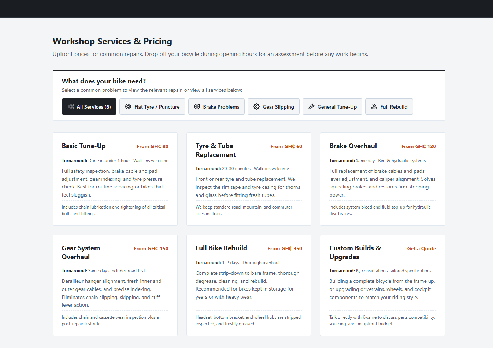
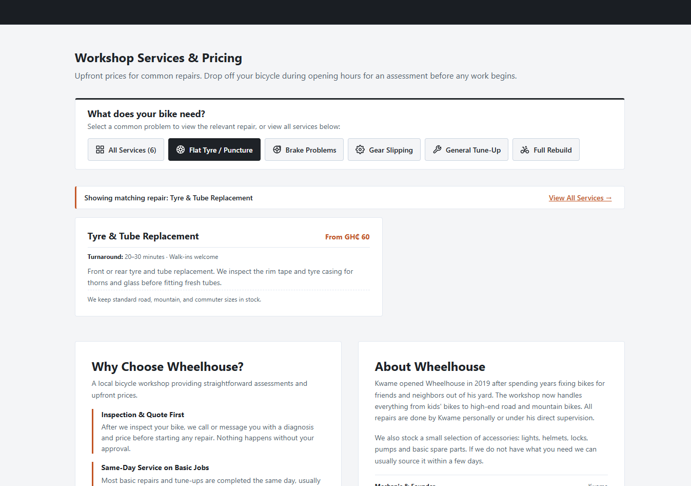

# EE01 — Additional Improvement

**Project:** Wheelhouse Bike Repair  
**Improvement:** Find Your Repair — Service Finder

## 1. Identified Customer Problem

Wheelhouse customers often search for bicycle repairs when they need urgent assistance. Some may recognise the problem with their bicycle but not know the technical name of the repair service they require.

Although the website displays all six services, customers may need to read multiple descriptions before identifying the most relevant option.

## 2. Proposed Improvement

I introduced the "Find Your Repair" feature (`.repair-finder`) that allows visitors to filter workshop services by selecting a familiar bicycle symptom or problem.

The feature provides **6 interactive filter controls** (1 "Show All" control plus 5 symptom-based problem filters):

- **All Services (6)** (`data-service-target="all"`): Displays the complete workshop catalogue of all six repair services.
- **Flat Tyre / Puncture** (`data-service-target="service-tyre"`): Filters directly to **Tyre & Tube Replacement** (`#service-tyre`).
- **Brake Problems** (`data-service-target="service-brakes"`): Filters directly to **Brake Overhaul** (`#service-brakes`).
- **Gear Slipping** (`data-service-target="service-gears"`): Filters directly to **Gear System Overhaul** (`#service-gears`).
- **General Tune-Up:** Basic Tune-Up (`data-service-target="service-tuneup"`, filters directly to `#service-tuneup`).
- **Full Rebuild** (`data-service-target="service-rebuild"`): Filters directly to **Full Bike Rebuild** (`#service-rebuild`).

*(Note: Custom Builds & Upgrades remains accessible as part of the full catalogue when "All Services (6)" is active.)*

By default, all six services remain visible. Selecting a problem filters the displayed services to the corresponding option. Visitors can toggle the selection off to restore all services, click another symptom, or use the "View All Services &rarr;" reset button.

## 3. Why I Chose This Improvement

My initial approach was to navigate to and highlight the relevant service card. However, the service cards were already positioned directly below the selection options, making this interaction less useful.

I revised the feature to filter the services instead.

This provides more meaningful assistance by reducing the amount of information visitors need to review when looking for a particular repair.

## 4. Value to the Business and Customers

**Customer value:** Visitors can identify relevant services more quickly without needing to understand bicycle repair terminology.

**Business value:** The feature makes Wheelhouse's services easier to explore and helps prospective customers reach relevant service information before contacting the workshop.

The improvement supports the owner's objective of providing a straightforward and professional experience for people comparing repair shops on their phones.

## 5. Scope and Limitations

The service finder is intended to help users discover relevant services, not diagnose mechanical problems.

It covers five common customer needs rather than every possible bicycle issue. Customers can still browse all six available services or contact Wheelhouse for assistance.

The feature does not provide automated quotations or guarantee that a selected service will resolve a particular problem.

## 6. Conclusion

Find Your Repair improves the usability of the service catalogue by helping customers narrow down their options based on familiar problems.

It is a practical improvement connected to Wheelhouse's customer needs rather than an additional decorative feature.

## 7. Implementation Evidence

### 7.1 Visual Evidence & Screenshots

The implementation evidence is captured in the repository screenshots below:

#### Default Unfiltered State
In its initial state, "All Services (6)" is active (`aria-pressed="true"`), and all six service cards are displayed in the workshop grid:



*Direct file link:* [service-finder-default.png](screenshots/service-finder-default.png)

#### Filtered State
When a customer selects a symptom chip (e.g., "Flat Tyre / Puncture"), the grid filters to display only the matching repair card, and a live status banner appears with an accessible reset option:



*Direct file link:* [service-finder-filtered.png](screenshots/service-finder-filtered.png)

### 7.2 HTML Controls & Semantics

The service finder is structured using semantic button controls contained within a labeled ARIA group:

```html
<div class="repair-finder">
  <div class="repair-finder-header">
    <h3 class="repair-finder-title">What does your bike need?</h3>
    <p class="repair-finder-subtitle">Select a common problem to view the relevant repair, or view all services below:</p>
  </div>
  <div class="repair-finder-grid" role="group" aria-label="Filter repairs by symptom">
    <button type="button" class="repair-finder-card" data-service-target="all" aria-pressed="true" aria-controls="services-grid">
      <!-- SVG icon -->
      <span>All Services (6)</span>
    </button>
    <button type="button" class="repair-finder-card" data-service-target="service-tyre" aria-pressed="false" aria-controls="services-grid">
      <!-- SVG icon -->
      <span>Flat Tyre / Puncture</span>
    </button>
    <!-- Additional problem buttons ... -->
  </div>
</div>

<!-- Accessible live region and reset action -->
<div id="service-filter-status" class="service-filter-status" aria-live="polite" hidden>
  <span class="filter-status-count" id="filter-status-count">Showing 1 matching service</span>
  <button type="button" id="reset-service-filter" class="filter-reset-btn">View All Services &rarr;</button>
</div>
```

Key markup characteristics:
- **Button Elements (`<button type="button">`):** Ensured full native keyboard focusability (Tab key) and activation via both `Enter` and `Space` keys without needing hacky anchor tag handlers.
- **ARIA Group Semantics:** `role="group"` with `aria-label="Filter repairs by symptom"` communicates the relationship between the chip buttons to assistive technologies.
- **Explicit Target Association:** `aria-controls="services-grid"` informs screen readers that button activation modifies the content of the services grid.
- **Visual Iconography:** Inline SVG icons represent each problem visually while remaining hidden from screen readers via `aria-hidden="true"`.

### 7.3 JavaScript Filtering Behaviour

The filtering logic is implemented in [`js/script.js`](../../js/script.js) via the `initServiceFilter()` module:

1. **Active State Toggle:** Each chip button tracks its selection state using `aria-pressed="true|false"`.
2. **Card Visibility Management:** When a specific symptom is selected, matching cards retain visibility while non-matching cards receive the native HTML `hidden` attribute (`card.hidden = true`).
3. **Toggle Off:** Clicking an already active filter button acts as a toggle, automatically reverting the view to display all services.
4. **Layout Class Adjustment:** Applying `.is-filtered` to the `#services-grid` container centers the single filtered card and optimizes its presentation.
5. **Reset Action:** Clicking the "View All Services &rarr;" reset button invokes `showAllServices(true)`, unhiding all cards, setting the "All Services (6)" button to `aria-pressed="true"`, hiding the status bar, and smoothly refocusing the first chip button for seamless keyboard navigation.

### 7.4 Accessibility Considerations

1. **State Communication:** The active filter is communicated both visually (dark charcoal background `#1e2227` with white text) and programmatically via `aria-pressed="true"`.
2. **Screen Reader Announcements (`aria-live="polite"`):** The status notification container (`#service-filter-status`) dynamically updates its message (e.g., *"Showing matching repair: Tyre & Tube Replacement"*). The `polite` setting ensures assistive technologies read the status update as soon as the user finishes their action without aggressively interrupting ongoing speech.
3. **Keyboard Focus Management:** When the user clicks the reset button, keyboard focus is intentionally moved back to the first filter button (`filterButtons[0].focus()`), preventing the user from losing their focus position in the document.
4. **Visible Focus Rings:** All buttons inherit the global `:focus-visible` styling (`outline: 3px solid #c25424; outline-offset: 2px`), ensuring keyboard operators clearly see their current focus.

### 7.5 Business Value Summary

For Kwame's workshop in Kumasi:
- **Reduces Cognitive Overhead:** An urgent customer whose gears are slipping doesn't have to read through six technical repair descriptions or guess what "Gear System Overhaul" means.
- **Transparent Expectations:** The customer sees the exact starting price (GH₵ 150) and turnaround time ("Same day · Includes road test") immediately.
- **Direct Conversion Pathway:** Provides direct links to call (`tel:0322000000`) or visit the workshop in Adum Commercial Area with confidence that Wheelhouse handles their exact problem.