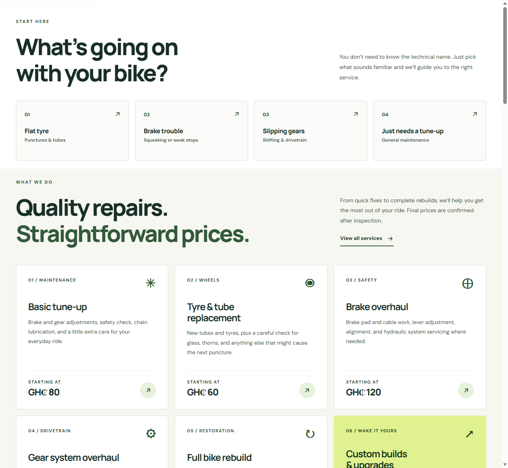
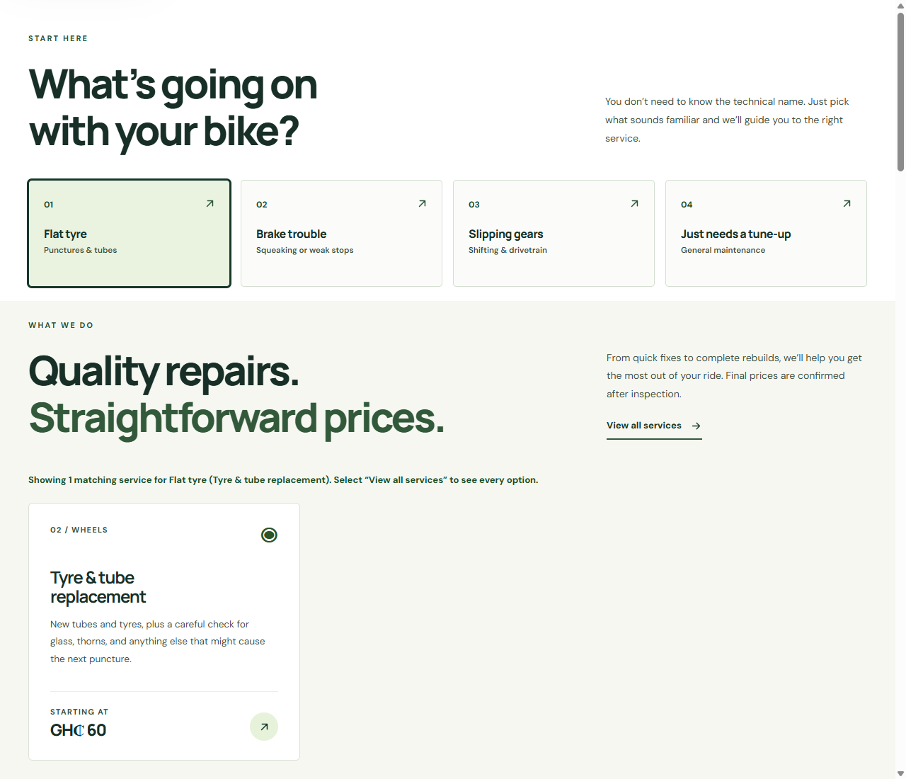

# EE01 — Additional Improvement

**Project:** Wheelhouse Bike Repair  
**Improvement:** Find Your Repair — Problem Selector & Service Filter  
**Module:** EE01 — Web & UI Essentials  

---

## 1. Identified Customer Problem

Wheelhouse customers frequently search for bicycle repairs when they need urgent assistance—often on their mobile phones while on the go in Adum or elsewhere in Kumasi. Many customers recognize the physical symptoms of their bike trouble (for example, "my chain slips when pedalling" or "my brakes squeak and feel weak"), but do not know the technical trade names used by bicycle mechanics (such as *Gear System Overhaul* or *Brake Overhaul*).

Although the website displays all six workshop services, having to read through all six technical descriptions before finding the right repair creates avoidable cognitive friction for a customer in a hurry.

---

## 2. Proposed Improvement

I introduced the **"What's going on with your bike?"** problem selector (`.problem-grid`), allowing visitors to filter workshop services by tapping a familiar bicycle symptom.

The feature provides **4 symptom-based problem filters** plus a dedicated **"View all services"** reset control:

- **Flat Tyre / Puncture:** Punctures & tubes (`data-filter="tyre"`) — filters directly to **Tyre & Tube Replacement** (`.service-card[data-category="tyre"]`).
- **Brake Trouble:** Squeaking or weak stops (`data-filter="brakes"`) — filters directly to **Brake Overhaul** (`.service-card[data-category="brakes"]`).
- **Slipping Gears:** Shifting & drivetrain (`data-filter="gears"`) — filters directly to **Gear System Overhaul** (`.service-card[data-category="gears"]`).
- **Just Needs a Tune-Up:** General maintenance (`data-filter="tuneup"`) — filters directly to **Basic Tune-Up** (`.service-card[data-category="tuneup"]`).
- **View All Services:** Reset action (`#reset-services`) — unhides all cards and restores the full 6-service workshop catalogue.

*(Note: Full Bike Rebuild and Custom Builds & Upgrades remain immediately accessible as part of the complete catalogue when all services are shown.)*

By default, all six services are visible. When a customer selects a problem card, the grid filters to display the matching repair, smoothly scrolls down to the `#services` section so the user sees the result without manual scrolling, and highlights the revealed card with a subtle glow animation. Tapping an active button toggles it off, or the customer can click **"View all services"** to restore all cards.

---

## 3. Further Aesthetic & Feel Improvements — Harmonious Colour Patterns and Workshop Identity

In addition to the interactive problem filter, the entire visual language, colour patterns, and sensory feel of the website were fundamentally elevated to create an authentic, trustworthy, and premium trade-workshop experience.

### 3.1 Eliminating the Starter Site's Inconsistent Styling
The original starter website suffered from scattered, discordant visual treatments: six service cards featured six unrelated bright border accents (clashing red, purple, orange, blue, green, and teal), harsh yellow text sat on slate blue headers, and typography was inconsistently sized inline. This fragmented presentation felt haphazard and failed to project the calm, deliberate craftsmanship Kwame brings to every bicycle repair.

### 3.2 Implemented Workshop Colour Patterns
To replace this dissonance, I introduced a unified, grounded colour palette under `:root` inspired by natural materials and precision mechanical tools:

- **Deep Forest Green (`--forest: #15382b`, `--forest-deep: #102b21`):** Represents dependable mechanical craftsmanship, workshop durability, and professional maturity. Used for key structural containers, primary headings, dark surfaces, and robust focus rings.
- **High-Contrast Brand Lime (`--lime: #def58c`, `--lime-dark: #c5ed63`):** Acts as a fresh, high-visibility accent colour. Applied to the primary *Request a repair* call-to-action button, active filter badges, and dark-surface focus rings, delivering **10.05:1** to **12.63:1** contrast (exceeding WCAG AAA).
- **Warm Canvas Cream (`--cream: #f7f7f1`) & Crisp White (`--paper: #ffffff`):** Softens the background into a warm, tactile workshop canvas, replacing sterile default greys and harsh stark whites with an inviting visual texture.
- **Deep Ink (`--ink: #182f27`, `--ink-2: #244638`):** Provides exceptional typographic clarity, ensuring body copy and metadata achieve **14.24:1** contrast on white surfaces.

### 3.3 Enhanced Tactile Feel and Interactive Feedback
The redesign gives the user interface a deliberate, tactile quality suited to an active bicycle repair shop:
- **Component Elevation & Shadows:** Content cards use soft, organic ambient drop shadows (`--shadow: 0 20px 60px rgba(15, 38, 24, 0.08)`) and subtle border lines (`1px solid #e3e9e1`) that create clean physical separation without visual clutter.
- **Reassuring Interactive States:** Buttons and problem tiles feature smooth tactile feedback upon hover and focus (`#eaf3df` active tint, `2px` inset focus ring, and subtle card elevation).
- **Modern Typography Hierarchy:** Pairing **Manrope** (bold, geometric headings) with **DM Sans** (clean, highly legible body text) balances modern editorial polish with utilitarian readability.

---

## 4. Why I Chose This Improvement

My initial exploration was merely to jump down the page and anchor-link to the service card. However, anchor jumping without filtering left all other services visible, meaning the user still had to scroll past irrelevant options.

Revising the feature into a true **client-side filter with automatic smooth scrolling** solves the customer problem much more effectively:
1. It eliminates information overload by hiding non-relevant services.
2. It guides the customer directly to their matching price and turnaround time.
3. It pre-selects the corresponding service in the repair booking form when the customer clicks the service card link.

---

## 5. Value to the Business and Customers

- **Customer Value:** Visitors find their repair in one tap without needing mechanical vocabulary. They see an honest starting price and clear scope immediately.
- **Business Value:** Kwame's workshop reduces time spent answering basic enquiries. Customers arrive at the workshop or initiate a WhatsApp enquiry already knowing which service they need.
- **Conversion Pathway:** Each service card features a direct action link (`.service-link`) that connects directly to the booking form (`#booking`) and pre-selects that specific service in the dropdown.

---

## 6. Scope and Limitations

- **Discovery Tool, Not Automated Diagnostics:** The problem selector is designed to help visitors find common repair categories, not diagnose complex or hidden mechanical issues.
- **Covers Common Everyday Needs:** The 4 symptom cards cover the vast majority of daily bicycle repairs in Kumasi (punctures, brake wear, drivetrain slipping, and routine servicing). Complex rebuilds and bespoke custom builds remain accessible in the full catalogue.
- **Indicative Starting Prices:** Published rates are indicative starting prices; final quotes are confirmed in person after Kwame inspects the bicycle.

---

## 7. Conclusion

The "What's going on with your bike?" selector directly addresses customer hesitation, supports mobile-first urgency, and bridges everyday language with professional bicycle repair services.

---

## 8. Implementation Evidence

### 8.1 Visual Evidence & Screenshots

The implementation is verified across the repository screenshots below:

#### Default Unfiltered State
All 4 problem tiles are in their unpressed resting state, and all six service cards are visible in the workshop catalogue:



*Direct file link:* [service-finder-default.png](screenshots/service-finder-default.png)

#### Filtered State
Selecting a problem tile (e.g., *Flat tyre*) updates the tile to `aria-pressed="true"`, filters `.services-grid` to the matching card, smoothly scrolls to `#services`, and announces the match via `#filter-note`:



*Direct file link:* [service-finder-filtered.png](screenshots/service-finder-filtered.png)

---

### 8.2 HTML Controls & Markup Semantics

The selector is implemented using native `<button type="button">` elements contained in an ARIA group landmark:

```html
<!-- Problem Selector Section -->
<section class="section problem-section" id="problems" aria-labelledby="problem-title">
  <div class="container">
    <div class="section-head compact">
      <div>
        <span class="section-kicker">START HERE</span>
        <h2 id="problem-title">What&rsquo;s going on<br>with your bike?</h2>
      </div>
      <p>You don&rsquo;t need to know the technical name. Just pick what sounds familiar and we&rsquo;ll guide you to the right service.</p>
    </div>

    <div class="problem-grid" role="group" aria-label="Filter repair services by symptom">
      <button class="problem-card" type="button" data-filter="tyre" aria-pressed="false"
        aria-controls="services-grid" aria-label="Flat tyre — Punctures and tubes">
        <span class="problem-icon">01</span>
        <span>Flat tyre <small>Punctures &amp; tubes</small></span>
        <svg class="icon" aria-hidden="true"><use href="#i-arrow-up" /></svg>
      </button>

      <button class="problem-card" type="button" data-filter="brakes" aria-pressed="false"
        aria-controls="services-grid" aria-label="Brake trouble — Squeaking or weak stops">
        <span class="problem-icon">02</span>
        <span>Brake trouble <small>Squeaking or weak stops</small></span>
        <svg class="icon" aria-hidden="true"><use href="#i-arrow-up" /></svg>
      </button>

      <button class="problem-card" type="button" data-filter="gears" aria-pressed="false"
        aria-controls="services-grid" aria-label="Slipping gears — Shifting and drivetrain">
        <span class="problem-icon">03</span>
        <span>Slipping gears <small>Shifting &amp; drivetrain</small></span>
        <svg class="icon" aria-hidden="true"><use href="#i-arrow-up" /></svg>
      </button>

      <button class="problem-card" type="button" data-filter="tuneup" aria-pressed="false"
        aria-controls="services-grid" aria-label="Just needs a tune-up — General maintenance">
        <span class="problem-icon">04</span>
        <span>Just needs a tune-up <small>General maintenance</small></span>
        <svg class="icon" aria-hidden="true"><use href="#i-arrow-up" /></svg>
      </button>
    </div>
  </div>
</section>

<!-- Services Section with Live Region and Reset Action -->
<section class="section services-section" id="services" aria-labelledby="services-title">
  <div class="container">
    <div class="section-head">
      <div>
        <span class="section-kicker">WHAT WE DO</span>
        <h2 id="services-title">Quality repairs.<br><em>Straightforward prices.</em></h2>
      </div>
      <div class="services-intro">
        <p>From quick fixes to complete rebuilds, we&rsquo;ll help you get the most out of your ride.</p>
        <button class="text-button" type="button" id="reset-services">
          View all services <svg class="icon" aria-hidden="true"><use href="#i-arrow" /></svg>
        </button>
      </div>
    </div>

    <!-- Screen Reader Live Status Region -->
    <p class="filter-note" id="filter-note" hidden role="status" aria-live="polite"></p>

    <div class="services-grid" id="services-grid">
      <!-- 6 service cards with data-category attributes -->
    </div>
  </div>
</section>
```

#### Key Semantic Attributes:
- **Native `<button type="button">` Elements:** Guaranteed full native keyboard access (Tab key navigation) and activation via both `Enter` and `Space` keys without synthetic event hacks.
- **ARIA Group Semantics:** `role="group"` with `aria-label="Filter repair services by symptom"` explicitly relates the four cards as an interactive filter control group.
- **Dynamic Toggle State:** `aria-pressed="false|true"` exposes the toggle state to assistive technologies.
- **Target Association:** `aria-controls="services-grid"` links each button directly to the services grid container.
- **Screen Reader Announcements:** `<p id="filter-note" role="status" aria-live="polite">` announces filtered results dynamically without interrupting active speech.
- **Decorative SVG Protection:** All embedded icons carry `aria-hidden="true"`, preventing screen-reader speech synthesizers from announcing unlabelled graphics.

---

### 8.3 JavaScript Filtering & Smooth-Scroll Flow

The interaction is powered by `initServiceFilter()` in [`js/script.js`](../../js/script.js):

```javascript
function initServiceFilter() {
  const problemButtons = document.querySelectorAll('.problem-card');
  const serviceCards = [...document.querySelectorAll('.service-card')];
  const filterNote = document.querySelector('#filter-note');
  const resetBtn = document.querySelector('#reset-services');

  if (!problemButtons.length || !serviceCards.length) return;

  const categoryNames = {
    tyre: 'Flat tyre (Tyre & tube replacement)',
    brakes: 'Brake trouble (Brake overhaul)',
    gears: 'Slipping gears (Gear system overhaul)',
    tuneup: 'General maintenance (Basic tune-up)'
  };

  function applyFilter(category, clickedButton) {
    const isCurrentlyActive = clickedButton && clickedButton.getAttribute('aria-pressed') === 'true';

    // Toggle off if clicking the already active button
    if (isCurrentlyActive || category === 'all') {
      serviceCards.forEach(card => {
        card.hidden = false;
        card.classList.remove('filter-highlight');
      });

      problemButtons.forEach(btn => {
        btn.setAttribute('aria-pressed', 'false');
      });

      if (filterNote) {
        filterNote.hidden = false;
        filterNote.textContent = 'Showing all 6 services.';
        setTimeout(() => {
          if (!document.querySelector('.problem-card[aria-pressed="true"]')) {
            filterNote.hidden = true;
          }
        }, 3000);
      }
      return;
    }

    // Filter to selected category
    let matchedCard = null;
    serviceCards.forEach(card => {
      const isMatch = card.dataset.category === category;
      card.hidden = !isMatch;
      card.classList.remove('filter-highlight');
      if (isMatch) matchedCard = card;
    });

    problemButtons.forEach(btn => {
      btn.setAttribute('aria-pressed', btn === clickedButton ? 'true' : 'false');
    });

    if (filterNote) {
      filterNote.hidden = false;
      const label = categoryNames[category] || category;
      filterNote.textContent = `Showing 1 matching service for ${label}. Select “View all services” to see every option.`;
    }

    // Scroll smoothly so both the filter status and full matching service card stay comfortably framed
    const servicesSection = document.querySelector('#services');
    if (servicesSection) {
      const isReduced = window.matchMedia('(prefers-reduced-motion: reduce)').matches;
      setTimeout(() => {
        const header = document.querySelector('.site-header');
        const mobileCta = document.querySelector('.mobile-cta');
        const sectionHead = servicesSection.querySelector('.section-head');
        const headerHeight = header ? header.getBoundingClientRect().height : 0;
        const ctaVisible = mobileCta && window.getComputedStyle(mobileCta).display !== 'none';
        const ctaHeight = ctaVisible ? mobileCta.getBoundingClientRect().height : 0;

        const minTop = headerHeight + 20;
        const usableBottom = window.innerHeight - ctaHeight - 24;
        const headTop = (sectionHead || servicesSection).getBoundingClientRect().top + window.scrollY;
        const anchorEl = (filterNote && !filterNote.hidden) ? filterNote : (matchedCard || servicesSection);
        const anchorTop = anchorEl.getBoundingClientRect().top + window.scrollY;
        const resultBottom = (matchedCard || anchorEl).getBoundingClientRect().bottom + window.scrollY;

        const idealScrollY = headTop - minTop;
        const fitCardScrollY = resultBottom - usableBottom;
        const maxFilterScrollY = anchorTop - minTop;
        const targetScrollY = Math.max(0, Math.min(maxFilterScrollY, Math.max(idealScrollY, fitCardScrollY)));

        window.scrollTo({
          top: targetScrollY,
          behavior: isReduced ? 'auto' : 'smooth'
        });

        if (matchedCard && !isReduced) {
          matchedCard.classList.remove('filter-highlight');
          void matchedCard.offsetWidth; // Force reflow
          matchedCard.classList.add('filter-highlight');
        }
      }, 60);
    }
  }

  problemButtons.forEach(button => {
    button.addEventListener('click', () => {
      applyFilter(button.dataset.filter, button);
    });
  });

  if (resetBtn) {
    resetBtn.addEventListener('click', () => {
      applyFilter('all', null);
      if (problemButtons.length > 0) {
        problemButtons[0].focus();
      }
    });
  }
}
```

---

### 8.4 Accessibility & Visual Styling

- **High-Contrast Focus Indicators:** All problem buttons inherit the global `:focus-visible` styling (`outline: 3px solid var(--forest); outline-offset: 3px;`), yielding **12.86:1** contrast on white/cream backgrounds.
- **Active State Affordance:** Active buttons display a solid forest green border (`border-color: var(--forest);`), tinted green background (`#eaf3df`), and a `2px` inset focus ring (`box-shadow: 0 0 0 2px var(--forest);`).
- **Focus Preservation:** When activating a problem filter, keyboard focus remains on the pressed button, enabling keyboard users to change their selection using Tab or Shift+Tab without disorientation.
- **Motion Preference Honoured:** When `prefers-reduced-motion: reduce` is enabled, the smooth scroll and card highlight transitions switch to instant execution.
