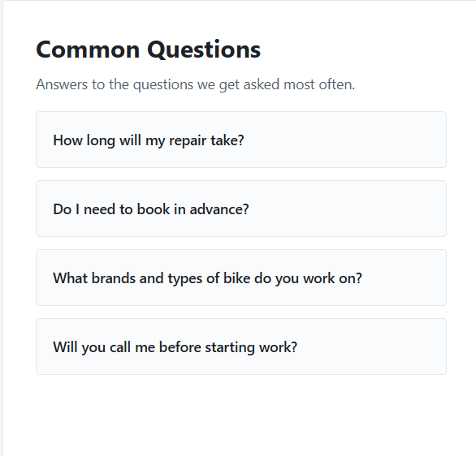
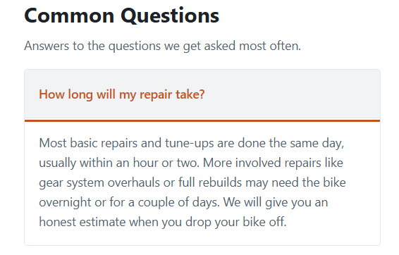
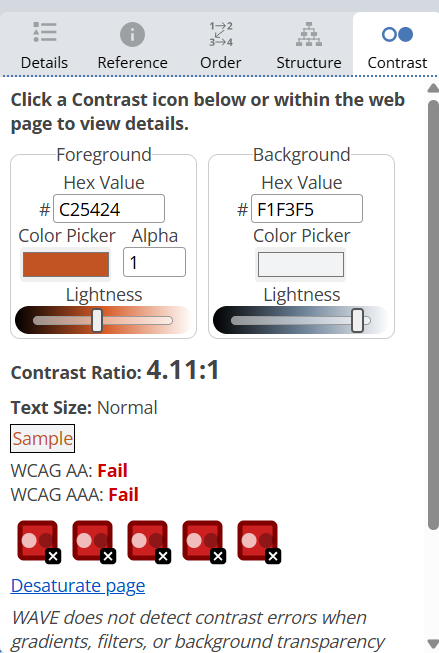
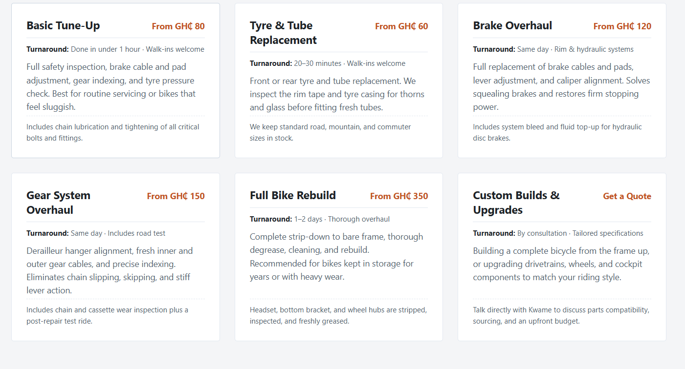

# Accessibility audit: Wheelhouse Bike Repair site by Zakari Muktar Junior

- Site audited: https://zakari999.github.io/wheelhouse-bike-repair/
- Date and time tested: 17 November 2026, 1:00 PM
- Audited by: Jeremiah Narteh Akuaku
- Standard: WCAG 2.2, level AA

## How I tested
- Automated tools: Google Lighthouse (Accessibility category, Chrome DevTools) and WAVE Evaluation Tool (WebAIM).
- Keyboard: Chrome 158.0.8127.36 on Windows 11, mouse not used. Journeys tested: finding the services and prices, reading the FAQ, finding the contact details, and completing the booking form (empty submission and successful submission).
- Zoom, text size and reflow: browser zoom at 200% and 400%, a 320px-wide view in DevTools device mode, and Chrome font size set to "Very large".
- Phone: Chrome DevTools device mode at phone size, with touch emulation. I completed the booking journey in the phone layout and checked that buttons and links looked large enough to tap.
- Screen reader: NVDA 2026.3.1 (portable copy, because installs are blocked on the test machine) with Chrome. Navigated by landmarks (D), headings (H) and form fields (Tab), and read line by line. Speech Viewer was used to capture exact announcements.
- Pages and journeys covered: the home page (the site is one page), covering the services and prices, the FAQ, the contact details and the booking form.

## Summary
The site is in good shape overall. Its headings and landmarks are well structured, it reflows cleanly at 400% zoom, every element can be reached with the keyboard, both form errors and the booking confirmation are announced to screen reader users, and the booking form works in the phone-sized layout. The most important problem is that the FAQ questions show no visible focus, so a keyboard-only user loses track of where they are. In that section the site fails the customer described in the brief. The orange text on the grey boxes also falls just short of the required contrast in five places, and the "Get a Quote" link is styled like a price, so it does not look clickable.

## Findings, in priority order

### 1. A keyboard user cannot see where they are in the FAQ
- Where: home page, "Common Questions" section, all four `summary.faq-trigger` elements.
- What happens: when the FAQ questions are collapsed, Tab does move focus to them (pressing Enter opens them), but nothing visible shows which one has focus. When a question is expanded, the only change is an orange bottom border and orange text. This border disappears when focus moves away, so it is the focus style, but a thin bottom line on one edge is hard to notice.
- How to reproduce:
  1. Load the page and click the address bar.
  2. Press Tab 23 times until focus has passed the last link before "Common Questions".
  3. Press Tab once more. Focus is now on "How long will my repair take?", but nothing on screen shows this.
  4. Press Enter. The question opens, which proves it had focus.
- Evidence: in the first screenshot, keyboard focus is on "How long will my repair take?", but nothing on screen shows it. The second shows the same question after pressing Enter: the only change is orange text and a thin orange line along the bottom edge.

  

  
- WCAG rule and principle: [2.4.7 Focus Visible](https://www.w3.org/WAI/WCAG22/Understanding/focus-visible.html) (Level AA), **Operable**.
- Who it affects and how: people who rely on the keyboard, including the customer in the brief with his arm in a cast, people with tremors or limited hand movement, and people using switch devices. It also affects screen magnifier users, whose view follows focus. They have to guess where they are, open the wrong question, or give up on the section.
- Found by: keyboard.
- Why it ranks here: it is exactly the barrier from the customer's complaint and affects every keyboard user. No scanner flags it, because Lighthouse and WAVE both passed the FAQ. It ranks first because it is the only finding that makes part of the site hard to use for a whole group of people. The other findings make things harder to read or notice, but they don't stop anyone.
- Suggested fix: add a clear `:focus-visible` style to `.faq-trigger`, for example `outline: 3px solid #B04A1F; outline-offset: -3px;`, and keep it separate from the open-state style. The negative offset draws the ring inside the question box, so the box's edges cannot hide it. Only a sliver of focus line shows today, which suggests the box is cutting it off.

### 2. Orange text on the grey boxes is harder to read than it should be
- Where: home page. WAVE flags five contrast errors, on the FAQ questions when expanded (`summary.faq-trigger`), the email link (`a.email-link`) and the "Prefer email?" box (`div.contact-email-block`).
- What happens: orange text sits on light grey boxes. Normal-size text needs a contrast ratio of at least 4.5:1, and these fall short.
- How to reproduce:
  1. Run WAVE on the home page and open the Contrast tab.
  2. Select a contrast error to see its colours and ratio.
- Evidence: the error shown in the screenshot is orange #C25424 on grey #F1F3F5, with a ratio of 4.11:1 for normal text, which fails AA. Lighthouse also reports the FAQ question, the email link and the "Prefer email?" box as failing contrast.

  
- WCAG rule and principle: [1.4.3 Contrast (Minimum)](https://www.w3.org/WAI/WCAG22/Understanding/contrast-minimum.html) (Level AA), **Perceivable**.
- Who it affects and how: people with low vision, older customers, people with colour vision deficiencies, and anyone reading a phone outdoors in bright sun. They may misread the email address or skip the FAQ entirely.
- Found by: Lighthouse and WAVE.
- Why it ranks here: it is a real failure confirmed by two tools, and one instance is a way to contact the shop. But the ratio is close to the threshold, most people can still read it, and phone and WhatsApp are still available, so it hurts less than finding 1.
- Suggested fix: the same orange gives about 4.6:1 on white, so it only fails on the grey. Either darken the orange to about #B04A1F (around 4.9:1 on #F1F3F5), or give these boxes a white background.

### 3. "Get a Quote" does not look like something you can click
- Where: home page, services section, "Custom Builds & Upgrades" card.
- What happens: "Get a Quote" is a link, but it uses exactly the same style as the non-clickable prices in the other cards ("From GH₵ 150", "From GH₵ 350"): orange, bold, top-right of the card, and no underline. Visitors will read it as a price label and not realise it is the way to start a custom build enquiry.
- How to reproduce:
  1. Scroll to the services cards.
  2. Compare "Get a Quote" with "From GH₵ 150". Nothing visual separates the link from the plain text.
  3. Tab to it. Only now does it turn out to be a link.
- Evidence: in the bottom row, "Get a Quote" (a link) looks exactly like "From GH₵ 150" and "From GH₵ 350" (plain text) in the cards beside it.

  
- WCAG rule and principle: related to [3.2.4 Consistent Identification](https://www.w3.org/WAI/WCAG22/Understanding/consistent-identification.html) (Level AA), **Understandable**. This is not a strict WCAG failure, because 3.2.4 is about the same feature looking the same across pages, and this site has one page. It goes against the same idea, though: something that works differently should look different. It is reported as a usability issue.
- Who it affects and how: sighted users generally, and especially people with cognitive or learning disabilities who rely on consistent visual cues to tell what is interactive. Custom builds are likely the highest-value jobs, and this enquiry route is easy to miss.
- Found by: keyboard and visual inspection.
- Why it ranks here: it does not lock anyone out, because the link works with the mouse, the keyboard and a screen reader. So it ranks lowest of the findings, but it is still worth fixing because of the business value.
- Suggested fix: style it as a button or an underlined link so it is clearly different from the prices.

### Advisory (not accessibility failures)
- The footer still says ©2023, which makes the site look out of date and undermines trust.
- No image at the top shows at a glance what the business does. Adding one would help visitors who understand pictures faster than text.
- In the phone-sized view, the "Prefer email?" label wraps onto two lines beside the email link, which looks cramped. Nothing is cut off, so it still passes 1.4.10 Reflow. Suggest putting the label above the email address on small screens.

## What works well
- **Structure:** NVDA announces the banner, navigation, main and footer landmarks, as well as named section regions, in order when navigating with D. Heading levels are in order with no skipped levels when navigating with H. This passes 1.3.1 Info and Relationships and 2.4.6 Headings and Labels.
- **Form feedback:** submitting the booking form empty makes NVDA announce the errors, and they appear next to the relevant fields (3.3.1 Error Identification). After a valid submission, NVDA announces the success message, so a screen reader user knows the booking went through (4.1.3 Status Messages).
- **Phone layout:** in Chrome's phone-sized view I completed a booking by tapping through the form. Buttons and links looked large enough to tap, and nothing overlapped.
- **Keyboard access:** every link, button and form field can be reached and used with Tab, Enter, Space and the arrow keys, with no keyboard traps (2.1.1, 2.1.2). Focus is visible everywhere except the FAQ.
- **Zoom and reflow:** at 400% zoom and at 320px width, content reflows into one column with no horizontal scrolling and nothing clipped (1.4.10). With large browser text the layout holds (1.4.4).
- **Automated scores:** Lighthouse scored 96/100 and WAVE gave an AIM score of 8.5/10, with contrast as the only error type. These scores only cover what can be detected automatically: finding 1 was found only by keyboard testing.

## Not tested, and limits of this audit
- Tested only on Windows with Chrome and NVDA. Not tested with VoiceOver (macOS/iOS), TalkBack (Android), JAWS, Firefox or Safari.
- Not tested on a real phone. The phone layout was checked in Chrome DevTools device mode only, so real one-handed thumb use (the customer's first attempt in the brief) and the phone's own larger-text setting were not tested.
- Not tested with speech recognition software (such as Windows Voice Access) or switch devices.
- The form's server-side behaviour (whether the booking actually reaches Kwame) was not checked.